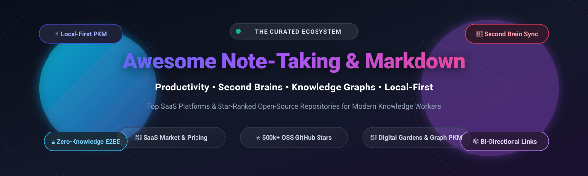
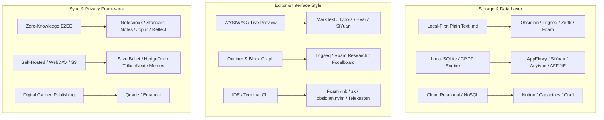
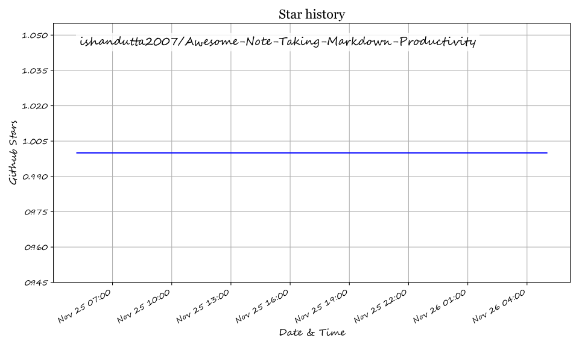

<picture>
  <source media="(prefers-color-scheme: dark)" srcset="assets/banner.svg">
  
</picture>

# 📝 Awesome Note-Taking & Markdown Productivity 🚀

**A comprehensive, SEO-optimized directory of top-tier SaaS platforms and star-ranked open-source GitHub repositories for note-taking, Markdown editing, bi-directional knowledge graphs, personal knowledge management (PKM), outliners, and local-first second brains.**

*Curated for knowledge workers, developers, researchers, technical writers, and lifelong learners.*

---

[🌐 Sector Overview](#-sector-overview--market-dynamics) •
[💎 SaaS & Hosted Platforms](#-saashosted-platforms) •
[⭐ Open-Source Repositories](#-open-source-github-projects) •
[🤝 How to Contribute](#-how-to-contribute) •
[💖 Support & Sponsorship](#-support--sponsorship-) •
[📊 Star History](#-star-history)

---

## 📌 Executive Summary & Key Highlights 🎯

In an era of information overload and fragmented knowledge, personal knowledge management (PKM) and structured plain-text Markdown workflows have become critical productivity levers. Whether building a personal "second brain" using bi-directional link graphs, maintaining private local-first vaults, or collaborating in real-time across distributed teams, modern note-taking software bridges intuitive ideation and systematic retention.

- 🔒 **Local-First & Data Ownership**: Future-proof plain-text files and SQLite/CRDT local-first databases guarantee full control over your intellectual property without cloud lock-in.
- 🕸️ **Networked Thought & Knowledge Graphs**: Interconnected wikilinks (`[[Note Title]]`), bi-directional references, and interactive dynamic graph visualizations uncover emergent insights.
- ⚡ **Extensible Markdown Power**: High-speed live-preview WYSIWYG editing, LaTeX math, Mermaid diagrams, code syntax highlighting, and custom community plugins.
- 🛡️ **Zero-Knowledge Encryption**: End-to-end encrypted (E2EE) sync engines safeguard sensitive thoughts against unauthorized third-party inspection.

---

## 🌐 Sector Overview & Market Dynamics 📈

The global note-taking and collaborative document software market was valued at approximately **$7.4 billion in 2024** and is projected to expand at an estimated **CAGR of ~14.8%** to exceed **$17.8 billion by 2031**, propelled by remote work adoption, developer-centric documentation workflows, and AI-assisted knowledge retrieval.

Market concentration exhibits a **moderately fragmented, bifurcated structure**:
1. **The Broad Enterprise Collaboration Tier**: Dominated by high-valuation mega-suites (e.g., Notion, Microsoft OneNote/Loop, Atlassian Confluence) competing for multi-seat enterprise contracts, team wikis, and all-in-one workspaces.
2. **The Local-First & Power-User PKM Tier**: A highly vibrant, fragmented ecosystem led by independent category leaders (e.g., Obsidian, Bear, Craft) alongside rapidly rising open-source contenders (e.g., AppFlowy, AFFiNE, Logseq, Joplin, Memos). In this segment, switching costs remain remarkably low due to standard plain-text Markdown portability, preventing single-vendor "winner-take-all" lock-in and continually fueling rapid bottom-up community innovation.

---

## 💎 SaaS/Hosted Platforms 🏢

The table below catalogs leading commercial and hosted note-taking platforms, sorted by **Company Size / Estimated Valuation or Revenue** (descending). All pricing and free tier allowances reflect exact starting tiers and specific limits.

| Product 🏷️ | Valuation / Est. Revenue 📊 | Starting Paid Tier Pricing 💳 | Free Forever Tier Limit / Trial Allowance 🎁 | Key Features & Architecture Highlights 💡 |
| :--- | :--- | :--- | :--- | :--- |
| **[Notion](https://notion.so)** | **$10.0B Valuation** (~$400M+ ARR) | **$10.00 / user / month** (billed annually at $120/yr) for Plus plan | **Free forever**: Unlimited blocks for individuals; 5 MB per file upload limit; 7-day page version history; up to 10 guest collaborators | All-in-one cloud workspace uniting relational databases, docs, task boards, Kanban, Markdown import/export, and optional Notion AI add-on. |
| **[Craft](https://craft.do)** | **$300M+ Est. Valuation** (~$15M+ ARR) | **$8.00 / member / month** (billed annually at $96/yr) for Plus plan | **Free forever**: Up to 10 documents / spaces; 1 GB cloud storage; 30-day version history; basic web publishing | Structured native Apple & web doc editor combining nested cards, daily notes, block styling, rich media embedding, and clean shareable web links. |
| **[Obsidian](https://obsidian.md)** | **$150M+ Est. Valuation** (Bootstrapped, ~$10M–$20M ARR) | **$4.00 / vault / month** (billed annually at $48/yr) for Obsidian Sync; $50/user/yr Commercial license | **Free forever**: 100% free for 100% of core app features, local vaults, canvas, graph view, and 1,500+ community plugins (self-sync via Git/iCloud/Drive permitted) | Premier local-first Markdown knowledge base and dynamic graph studio storing notes as plain text on your hard drive with zero cloud lock-in. |
| **[Roam Research](https://roamresearch.com)** | **$200M Valuation** (~$5M–$10M ARR) | **$15.00 / month** (billed annually at $180/yr) for Pro plan | **30-Day Free Trial** with full unlimited access to all features and graphs (no permanent free tier; credit card required to start) | Pioneering bi-directional graph outliner built for non-linear networked thinking, daily journals, side-by-side block references, and transclusion. |
| **[Bear](https://bear.app)** | **~$5M–$8M ARR** (Shiny Frog, Bootstrapped) | **$2.99 / month** (or **$29.99 / year**) for Bear Pro | **Free forever on single device**: Unlimited notes, tags, Markdown export, and core editor; iCloud multi-device sync, themes, and PDF search require Pro (14-day Pro trial) | Beautiful, minimalist native Markdown writer for macOS, iOS, and iPadOS featuring folding headings, nested hashtags, OCR search, and inline previews. |
| **[Ulysses](https://ulysses.app)** | **~$4M–$6M ARR** (Bootstrapped) | **$5.99 / month** (or **$39.99 / year**) for all-device subscription | **7-Day Free Trial** with full unlimited app access; read-only lock after trial expires (no permanent free tier) | Dedicated Markdown writing studio for novelists, journalists, and bloggers with distraction-free typewriter mode, manuscript compile, and direct CMS publishing. |
| **[Typora](https://typora.io)** | **~$3M–$5M ARR** (Indie) | **$14.99 one-time purchase** (perpetual license for up to 3 devices) | **15-Day Free Trial** with full unlimited functionality across Windows, macOS, and Linux; editor locks after trial | Distraction-free live-preview Markdown editor that replaces syntax tokens with rendered typography the moment you finish typing. |
| **[iA Writer](https://ia.net)** | **~$3M–$5M ARR** (Information Architects) | **$29.99 one-time** on macOS / iOS / Windows (per platform) | **14-Day Free Trial** on macOS / Windows with full feature access; no recurring fee | Renowned typographic writing environment featuring syntax color highlight (nouns/verbs/adjectives), sentence focus mode, and clean plain-text drafting. |
| **[Capacities](https://capacities.io)** | **~$2M–$4M ARR** (Bootstrapped Studio) | **$10.00 / month** (billed annually at $120/yr) for Capacities Pro | **Free forever**: Unlimited spaces, objects, notes, and media uploads; limited to 5 AI queries/day; mobile app & cloud sync included | Object-based "studio for your mind" that organizes thoughts into distinct database entities (People, Projects, Books, Meetings) with interconnected Markdown. |
| **[Reflect Notes](https://reflect.app)** | **~$1M–$3M ARR** (Indie) | **$10.00 / month** (billed annually at $120/yr) | **14-Day Free Trial** with full end-to-end encrypted note graph, Whisper AI audio transcription, and calendar integrations (no permanent free tier) | Ultra-fast networked note-taking app featuring end-to-end encryption, automatic daily log generation, bidirectional backlinks, and OpenAI Whisper voice capture. |

---

## ⭐ Open-Source GitHub Projects 💻

Below is the definitive index of open-source note-taking, Markdown editors, and local-first second brains, ranked strictly by **GitHub Stargazer Count** (descending). Each repository features a live Stars_Badge linking directly to its GitHub stargazers page.

| Repository & GitHub_Stars ⭐ | Architecture & Primary Stack 🛠️ | Description & Core Highlights 📖 |
| :--- | :--- | :--- |
| **[AppFlowy](https://github.com/AppFlowy-IO/AppFlowy)**  | Flutter, Rust, SQLite | Leading open-source Notion alternative. Provides local-first block/Markdown documents, customizable relational database tables, Kanban boards, and privacy-first AI offline support. |
| **[AFFiNE](https://github.com/toeverything/AFFiNE)**  | TypeScript, Rust, React, CRDT | Next-generation unified collaborative knowledge base merging structured Markdown docs, mind maps, spreadsheets, and an infinite spatial canvas with privacy-first sync. |
| **[Memos](https://github.com/usememos/memos)**  | Go, TypeScript, React, SQLite | Lightweight, self-hosted micro-note and quick-capture knowledge hub. Features a personal Twitter/Mastodon-style chronological timeline, Markdown tagging, and RESTful APIs. |
| **[MarkText](https://github.com/marktext/marktext)**  | JavaScript, Electron, Vue | Elegant, real-time preview distraction-free desktop Markdown editor (open-source alternative to Typora) supporting CommonMark, GFM, math formulas, and code blocks. |
| **[Joplin](https://github.com/laurent22/joplin)**  | TypeScript, React Native, Electron | Robust, feature-complete note-taking and to-do application with end-to-end encryption (E2EE), web clipper, Markdown editor, and multi-cloud sync (Nextcloud, WebDAV, Dropbox, S3). |
| **[SiYuan](https://github.com/siyuan-note/siyuan)**  | TypeScript, Go, SQLite | Privacy-first personal knowledge management system with granular block-level bidirectional referencing, WYSIWYG Markdown typing, SQL querying, mindmaps, and mobile clients. |
| **[Logseq](https://github.com/logseq/logseq)**  | ClojureScript, Electron | Privacy-first, local-first outliner and networked thought platform built on raw plain-text Markdown and Org-mode files with bi-directional wikilinks, PDF annotation, and flashcards. |
| **[Focalboard](https://github.com/mattermost-community/focalboard)**  | TypeScript, Go, React | Open-source, multilingual, self-hosted project and document management board (alternative to Trello, Notion, and Asana) by Mattermost. |
| **[Foam](https://github.com/foambubble/foam)**  | TypeScript, VS Code Extension | Extensible personal knowledge management and second brain platform built directly inside Visual Studio Code using standard Markdown files, Git, and graph visualizations. |
| **[BoostNote](https://github.com/BoostIO/BoostNote-Legacy)**  | JavaScript, Electron, React | Pioneering open-source Markdown note-taking application designed for programmers, featuring code snippet storage, syntax highlighting for 100+ languages, and offline search. |
| **[Notesnook](https://github.com/streetwriters/notesnook)**  | TypeScript, React Native, XChaCha20 | Fully open-source, zero-knowledge encrypted note-taking alternative to Evernote. Cross-platform sync, rich Markdown shortcuts, vault locks, and zero trackers. |
| **[Zettlr](https://github.com/Zettlr/Zettlr)**  | TypeScript, Electron, CodeMirror | Academic Markdown publication workbench and Zettelkasten powerhouse with seamless Zotero / JabRef citation support, Pandoc PDF rendering, and statistics. |
| **[Quartz](https://github.com/jackyzha0/quartz)**  | TypeScript, Node.js | Fast, batteries-included static site generator that transforms Obsidian/Logseq local Markdown vaults into interactive, bi-directionally linked Digital Garden websites. |
| **[VNote](https://github.com/vnotex/vnote)**  | C++, Qt | Native, lightning-fast Markdown note-taking platform tailored for programmers with Vim keybindings, directory-based notebook hierarchy, Typst support, and MindMaps. |
| **[Blinko](https://github.com/blinkospace/blinko)**  | TypeScript, Next.js, PostgreSQL | Modern open-source, self-hosted personal AI note-taking and fleeting thought capture hub prioritizing privacy, vector embeddings, and RAG search. |
| **[Anytype](https://github.com/anyproto/anytype-ts)**  | TypeScript, Go (Anylink), P2P | Local-first, peer-to-peer encrypted workspace combining object-oriented note architecture, Markdown blocks, offline sync, and cryptographic data self-sovereignty. |
| **[nb](https://github.com/xwmx/nb)**  | Bash, Pandoc, Git | Command-line and local web plain-text note-taking, bookmarking, and archiving assistant in a single portable script with Git versioning, encryption, and Pandoc conversions. |
| **[FSNotes](https://github.com/glushchenko/fsnotes)**  | Swift (macOS / iOS) | Blazing-fast native macOS and iOS Markdown note-taking app utilizing plain-text files stored in local folders with multi-tab viewing and iCloud sync. |
| **[HedgeDoc](https://github.com/hedgedoc/hedgedoc)**  | TypeScript, Node.js, React | Open-source web-based collaborative real-time Markdown editor (formerly CodiMD) for co-authoring meeting minutes, technical documents, and slide presentations. |
| **[Dendron](https://github.com/dendronhq/dendron)**  | TypeScript, VS Code Extension | Developer-focused hierarchical Markdown knowledge management system inside VS Code engineered to scale to tens of thousands of notes using flexible dot-notation schemas. |
| **[Standard Notes](https://github.com/standardnotes/app)**  | TypeScript, React, Electron | Privacy-obsessed, zero-knowledge end-to-end encrypted note-taking app offering rich Markdown editors, code syntax, spreadsheets, and decentralized self-hosting. |
| **[SilverBullet](https://github.com/silverbulletmd/silverbullet)**  | TypeScript, Deno, CodeMirror | Extensible, programmable local-first personal knowledge base running in the browser and powered by clean Markdown, Lua scripts, live queries, and offline PWA capability. |
| **[obsidian.nvim](https://github.com/epwalsh/obsidian.nvim)**  | Lua, Neovim | Seamless Neovim integration plugin for writing, searching, and managing Obsidian Markdown vaults with fuzzy backlink search and template creation. |
| **[QOwnNotes](https://github.com/pbek/QOwnNotes)**  | C++, Qt 6 | Fast, open-source desktop notepad and todo-list manager storing notes as plain Markdown files with complete Nextcloud/ownCloud note and file synchronization. |
| **[TriliumNext](https://github.com/TriliumNext/Notes)**  | JavaScript, Node.js, SQLite | Hierarchical personal knowledge base featuring deep tree organization, Markdown editing, mindmap visualizations, script execution, and robust self-hosted sync. |
| **[zk](https://github.com/zk-org/zk)**  | Go, SQLite | Ultra-fast command-line plain-text Zettelkasten assistant that indexes Markdown files, computes backlink graphs, and integrates with modern terminal editors and LSP. |
| **[Telekasten.nvim](https://github.com/nvim-telekasten/telekasten.nvim)**  | Lua, Neovim, Telescope | Neovim plugin for navigating and authoring a Markdown Zettelkasten wiki, daily journaling, backlinks, and image clipboard paste powered by Telescope. |
| **[Emanote](https://github.com/srid/emanote)**  | Haskell | Fast static website generator and live wiki viewer for local plain-text Markdown vaults with instant live-reload and deep bi-directional linking. |
| **[zk-nvim](https://github.com/zk-org/zk-nvim)**  | Lua, Neovim | Official Neovim extension providing Language Server Protocol (LSP) commands, auto-completion, and picker integrations for the `zk` note-taking CLI. |
| **[klad](https://github.com/klad-app/klad)**  | TypeScript, React | Innovative visual canvas and notes application built specifically for smooth human and AI agent collaborative workflows. |

---

## 🔍 Architecture & Taxonomy Comparison 🏗️

---

## 💡 How to Choose Your Note-Taking Stack 🧭

Depending on your daily workflows and privacy sensitivity, consider the following battle-tested setups:

1. **The Academic & Scientific Researcher** 🎓  
   - *Core Editor*: **[Zettlr](https://github.com/Zettlr/Zettlr)** or **[Obsidian](https://obsidian.md)**  
   - *Companions*: Zotero (via Better BibTeX plugin), Pandoc, and LaTeX math.  
   - *Outcome*: Citation-dense papers, rigorous Zettelkasten slip-boxes, and instant PDF rendering.

2. **The Privacy-Obsessed Digital Sovereign** 🛡️  
   - *Core Editor*: **[Logseq](https://github.com/logseq/logseq)** or **[SiYuan](https://github.com/siyuan-note/siyuan)** or **[Notesnook](https://github.com/streetwriters/notesnook)**  
   - *Companions*: Syncthing or Git backup over private NAS / S3.  
   - *Outcome*: 100% offline functionality, Zero-Knowledge cryptographic privacy, and absolute data custody.

3. **The Software Engineer & Terminal Hacker** 💻  
   - *Core Editor*: **[obsidian.nvim](https://github.com/epwalsh/obsidian.nvim)**, **[zk](https://github.com/zk-org/zk)**, or **[Foam (VS Code)](https://github.com/foambubble/foam)**  
   - *Publishing*: **[Quartz](https://github.com/jackyzha0/quartz)** to host personal docs on GitHub Pages.  
   - *Outcome*: Ultra-fast keystroke-driven workflows directly embedded into your development environment.

4. **The All-In-One Enterprise Team Planner** 👥  
   - *Core Platform*: **[Notion](https://notion.so)** or **[AppFlowy](https://github.com/AppFlowy-IO/AppFlowy)** / **[AFFiNE](https://github.com/toeverything/AFFiNE)**  
   - *Companions*: Kanban boards, relational project matrices, and team wikis.  
   - *Outcome*: Seamless team alignment, shared sprint dashboards, and unified company knowledge bases.

---

## 🤝 How to Contribute 🌟

We welcome contributions from creators, maintainers, and PKM enthusiasts! To add or update an entry:

1. 🍴 **Fork the repository** on GitHub.
2. 🌿 **Create a new branch** (`git checkout -b feature/add-new-tool`).
3. 📝 **Add or update your entry** in `README.md`:
   - For SaaS tools: Include verified pricing, free tier limits, company valuation/revenue, and official links.
   - For Open-Source tools: Include the full repository name, a live Stars_Badge (`style=social&color=white`) linked to `/stargazers`, tech stack, and a clear architectural summary.
4. 🚀 **Submit a Pull Request** with a concise description of your additions.

---

## ⚠️ Disclaimer 📋

- This repository is a **community-curated index** provided for educational and informational purposes. Mention does not constitute an explicit endorsement.
- Plain-text Markdown notes stored in public cloud-synced folders (e.g., Dropbox, Google Drive, OneDrive) are unencrypted at rest on third-party servers unless client-side encryption is configured. Use zero-knowledge E2EE applications (`Notesnook`, `Standard Notes`, `Joplin`) for sensitive data.
- Regularly maintain verified offsite backups of your personal vaults to prevent data loss from sync conflicts or disk errors.

---

## 💖 Support & Sponsorship ☕

Thank you so much for exploring and using this curated resource! Maintaining and continuously updating this ecosystem list takes substantial research and community diligence.

If you find this repository valuable:
- ⭐ **Star** this repository to show your support and help others discover it.
- 🍴 **Fork** and contribute additions, corrections, or tools to keep the guide comprehensive.
- 📢 **Share** it with your fellow writers, developers, PKM practitioners, and teams.
- ☕ **Buy me a coffee / Sponsor**: If you'd like to support ongoing maintenance and new open-source initiatives, check out the [GitHub Sponsor Dashboard](https://github.com/sponsors/ishandutta2007). Your sponsorship is deeply appreciated!

---

## 📊 Star History

**Made with ❤️ for writers, researchers, engineers, and lifelong thinkers worldwide.**  
*Star ⭐ this repo if it helps elevate your personal productivity and knowledge workflow!*

## Star History

<a href="https://star-history.com/#ishandutta2007/Awesome-Note-Taking-Markdown-Productivity&Timeline" align="center">
  <picture>
    <source media="(prefers-color-scheme: dark)" srcset="assets/ishandutta2007_Awesome-Note-Taking-Markdown-Productivity_growth.svg">
    
  </picture>
</a>
